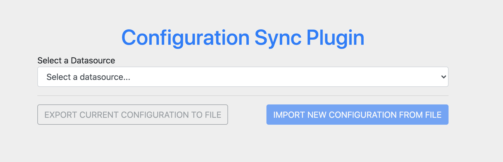
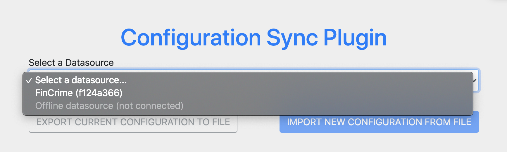
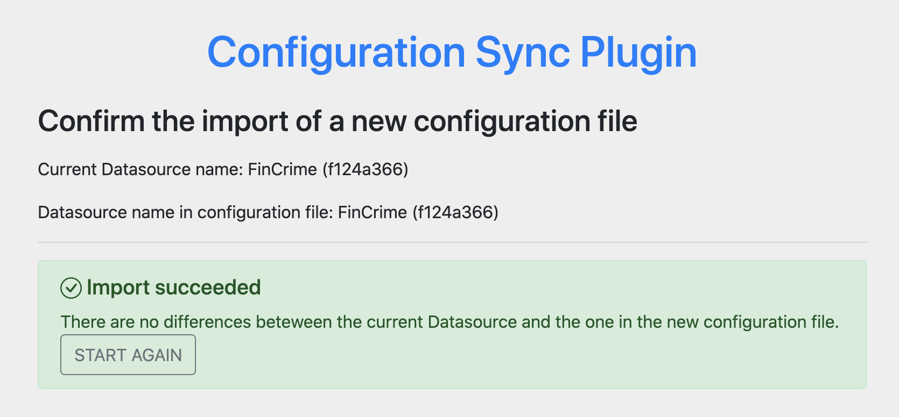
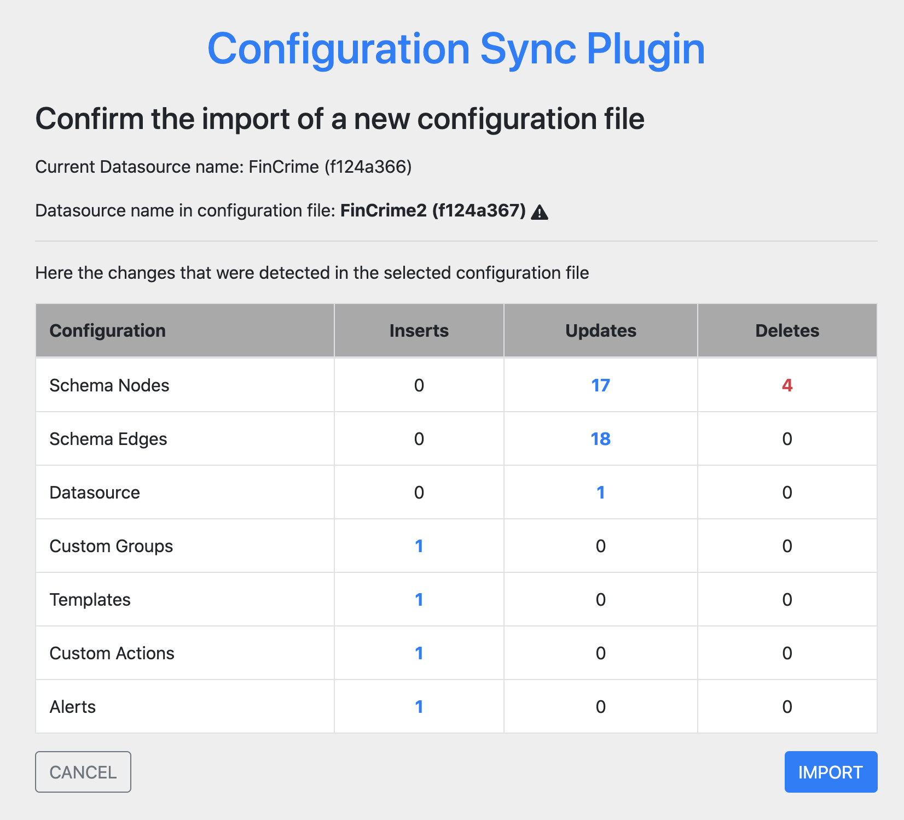
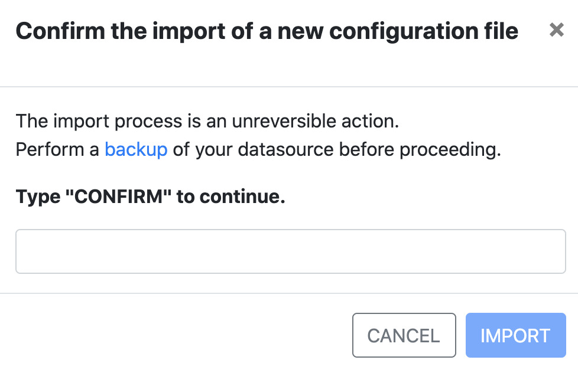

# Configuration Migration Plugin

## Description

The `Configuration Migration` is an official plugin designed to support the deployment of Linkurious Enterprise in a controlled environment having multiple environments (DEV, UAT, PROD etc.) where there is the need to promote configurations from a lower environment to an upper one.

The plugin synchronizes configurations (see below what is in scope) between environments through two operations:
1. Export configurations from a datasource to a JSON file, usually from a lower environment.
2. Import configurations from a JSON file exported by a compatible version of the plugin into a datasource, usually in an upper environment.

> Synchronization can delete configurations from the `destination` datasource to align it with the `source`.

Export and import can also be useful in other contexts.

The main screen looks like this:


> The plugin is not intended to migrate configurations between different major or minor versions of Linkurious Enterprise. An error is shown if the source and destination versions do not match on major and minor version. The export format versions must also match.

### Versioning

The plugin depends on the Linkurious Enterprise version because configurations can change as features are added. It also relies on Linkurious Enterprise APIs, so breaking API changes can affect compatibility.

The plugin is versioned as vX.Y.Z:
* X increases when the plugin's core functionality changes.
* Y increases when the plugin is adapted and tested for a newer version of Linkurious Enterprise.
* Z increases for patches or non-breaking changes to a specific Y version.
For more details, see [Prerequisites](#prerequisites).

Examples:
* v0.1.3 is the third patch release of v0.1 and can be used on systems running earlier v0.1 releases.
* v0.2.0 introduces changes that may require a newer version of Linkurious Enterprise.

The plugin manifest specifies a minimum Linkurious Enterprise version. The plugin cannot start on versions below that minimum.

### Prerequisites

* Linkurious Enterprise v4.3.13+
* A connected datasource in Linkurious Enterprise


## Configuring the Plugin

Here is an example configuration in the `Plugin settings` section of Linkurious Enterprise:
```json
{
  "config-migration": [
    {
      "basePath": "config-migration",
      "disableServices": ["queries", "templates", "custom_actions", "alerts"]
    }
  ]
}
```

* `enableServices` (optional): a list of services to enable for import. See [Data Migration Scope](#data-migration-scope) for accepted values. Cannot be used with `disableServices`.
* `disableServices` (optional): a list of services to disable for import. See [Data Migration Scope](#data-migration-scope) for accepted values. Cannot be used with `enableServices`.

> Selecting a subset of services does not affect the export, which includes all supported configurations. Enabled services must include their dependencies, or the plugin will not start.

The simplest configuration for migrating only the schema is:
```json
{
  "config-migration": [
    {
      "basePath": "schema-migration",
      "enableServices": [
        "schema_nodes",
        "schema_edges"
      ]
    }
  ]
}
```

### User Account Recommendations

The plugin acts on behalf of the current user for export and import operations. The user must belong to the built-in `admin` group. Exports are limited to items accessible to that user.

## How to use the plugin

To access the plugin, open `https://<your-linkurious-instance>/plugins/config-migration` or use the pre-configured plugin action in Linkurious Enterprise.

The plugin must be deployed on both the `source` and `destination` Linkurious Enterprise servers.

### Export Feature

1. Access the plugin home page on the `source` Linkurious Enterprise server
2. Select the desired datasource to export from the connected one
   
3. Press `EXPORT` to download the JSON file to your computer

> You are responsible for ensuring the security and integrity of the exported file.

#### How to handle errors

Export can fail if a Linkurious Enterprise API call fails or if an object is shared with groups but has no groups assigned. Check the API error and plugin compatibility, or correct the object's sharing settings before retrying.


### Import Feature

1. Perform a backup of the `destination` Linkurious Enterprise server
   > Restoring a backup is the only safe procedure to revert changes in case of critical unhandled errors.
2. Make the file available to the browser used for the import
3. Access the plugin home page on the `destination` Linkurious Enterprise server
4. Select the destination datasource
   
5. Press `IMPORT` and select the configuration file

#### No changes detected

If the file contains no changes compared to the current configuration, no action is required.

The plugin shows a confirmation page similar to the following:


#### Changes detected

If the file contains changes, the plugin shows a summary and asks you to confirm before applying them:


The first lines show:
* The datasource selected as the destination of the import
* The source datasource recorded in the file

> A *warning sign* appears if the *datasource names* do not match. A *source key* mismatch is common when promoting configurations.

The table lists the changes to be applied after confirmation:
* Each row represents a configuration type. See [Data Migration Scope](#data-migration-scope) for details.
* Rows are sorted by import order; all changes in one row are applied before the next row.
* The remaining columns show the number of objects affected by `insert`, `update`, and `delete` actions.
* Click a number to inspect the changes in JSON format. Each change includes `newValue` or `oldValue`; updates include both for comparison.

After reviewing the changes, click `IMPORT` and confirm the operation:


#### How to handle errors

The plugin uses Linkurious Enterprise APIs for export and import. It orders API calls to resolve configuration dependencies and avoid conflicts.

An API call can still fail if a prerequisite is not met or an unexpected error occurs.

When this happens, the import is aborted and the system may be partially updated. The plugin reports the failing action and its reason. After correcting the problem, retry the import; changes that have already been synchronized will no longer appear.

If the system is left in an unrecoverable state, or changes to internal IDs cause problems, restore the user-data store backup.


## Data Migration Scope

The plugin migrates datasource-specific Linkurious Enterprise configurations that can be reused on another instance.

The following are outside its scope:
* Global configuration unrelated to a specific datasource, such as authentication and web server settings
* Datasource connection configuration, such as database connection strings and index server settings
* Users and their private objects, such as visualizations and private queries

> New items may receive different internal IDs in the destination system. Do not hardcode these IDs.
>
> The plugin maps IDs used in security and sharing settings, but does not rewrite IDs in other content, such as queries or custom actions. Many resources are matched by UUID when comparing configurations.
> 
> If a shared object is made private in the source system, it is no longer exported. A subsequent import may delete the corresponding object from the destination when its service is enabled.

The following configurations are in scope:
* **Schema Nodes** (service: `schema_nodes`): schema definitions for node categories and their properties, including visibility and types.

  > These objects cannot be physically deleted. A `delete` action sets their visibility to none.
* **Schema Edges** (service: `schema_edges`): schema definitions for edge types and their properties, including visibility and types.

  > These objects cannot be physically deleted. A `delete` action sets their visibility to none.
* **Datasource** (service: `datasource`): datasource settings such as `Strict Schema`, `Property Key Access Right`, `Default Styles`, `Default Captions`, and the default property order.

  > All changes are represented as a single `update` action.
  >
  > `Default Styles` and `Default Captions` are each represented by a single JSON object. Any change to either is treated as a change to the whole object.
* **Custom Groups** (service: `custom_groups`, requires `datasource`, `schema_nodes`, and `schema_edges`): custom groups and their access rights. Built-in groups are excluded because they are created by the system.

  > Custom group IDs may differ from those in the source system, potentially affecting group mappings with external systems. Updating those mappings is outside the plugin's scope.
* **Query Tags** (service: `tags`): query tags and their colors.
  > Query tag assignments are synchronized by the query services.
* **Queries** (service: `queries`, requires `custom_groups`, `schema_nodes`, `schema_edges`, and `tags`): shared static queries and their sharing settings.
* **Queries with Dynamic Inputs** (service: `templates`, requires `custom_groups`, `schema_nodes`, `schema_edges`, and `tags`): shared queries with dynamic inputs and their sharing settings.
* **Custom Actions** (service: `custom_actions`, requires `custom_groups`): shared custom actions and their sharing settings.
* **Import Templates** (service: `import_templates`, requires `custom_groups`): shared import templates, including their type, entity configurations, CSV delimiter, and sharing settings.
* **Alerts** (service: `alerts`, requires `custom_groups`): not private Alerts' definition, their models and their folder organization

  > Deleting alerts, but not their models, deletes their cases.
* **Spaces** (service: `spaces`, requires `custom_groups`): spaces and their sharing settings.

  > Non-empty spaces cannot be deleted. They are skipped during import, and the final comparison reports the remaining differences.
* **Node Grouping Rules** (service: `node_grouping_rules`, requires `schema_nodes`): supported node grouping rule definitions for the datasource.

  > Rules based on adjacent edge type are skipped. When a supported rule changes, the plugin deletes and recreates it because the update API is unavailable. Existing visualizations that use the deleted rule will show ungrouped nodes after synchronization.

## Audit Trail

The plugin logs import actions and errors, including the connected user, to help investigate problems. Logs are available at `<linkurious>/data/logs/plugins/config-migration.log`; the filename may differ depending on the plugin configuration.

## Limitations

* Export and import can be performed only on datasources in the `ready` state.
* Some updates may not be applied even when the API returns no error. The plugin reports this after comparing the configurations again. For example, a numeric property indexed on a datasource using Elasticsearch may not be supported on a destination using Neo4j Search.
* Non-empty spaces cannot be deleted.


## Available Custom APIs

### Export
Export the current configuration of a datasource.
* HTTP Verb: `GET`
* API Endpoint: `/api/export/:datasource?download=false`
* URL Parameters:
  * `datasource` (mandatory) \[string\]: the key of a ready datasource to export
  * `download` (optional) \[bool\]: set to `true` to download the configuration directly
* Returns a JSON object with the configuration in `config`, or the configuration itself when `download=true`

### Compare
Compare two configurations.
* HTTP Verb: `POST`
* API Endpoint: `/api/compare/:datasource`
* URL Parameters:
  * `datasource` (mandatory) \[string\]: the key of a ready datasource to compare against; use `00000000` when supplying `old` in the body
* Body: a JSON object containing:
  * `old` (optional) \[object\]: the exported reference configuration; defaults to the current datasource configuration
  * `new` (mandatory) \[object\]: the exported configuration representing the desired state
* Returns a JSON object whose `diffs` attribute contains the changes needed to align `old` with `new` for the enabled services

### Import
* HTTP Verb: `PATCH`
* API Endpoint: `/api/import/:datasource`
* URL Parameters:
  * `datasource` (mandatory) \[string\]: the key of the destination datasource
* Body: an array of changes to apply, compatible with the results of the [compare](#compare) API
* Returns a confirmation JSON object
